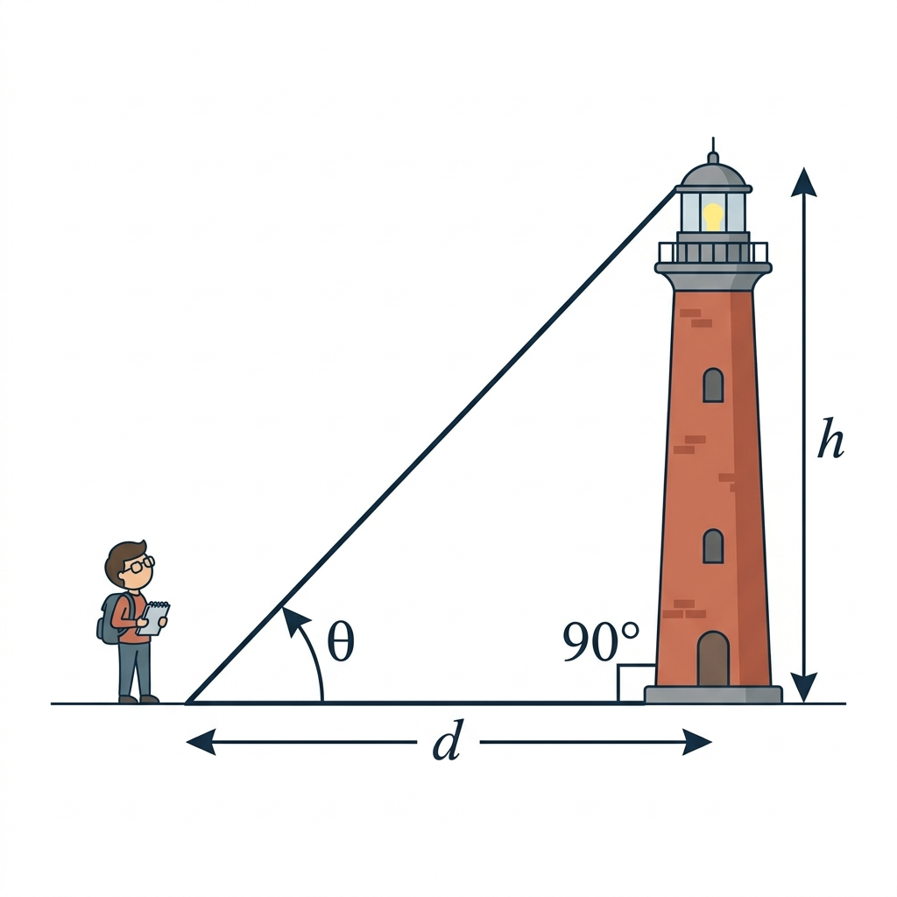
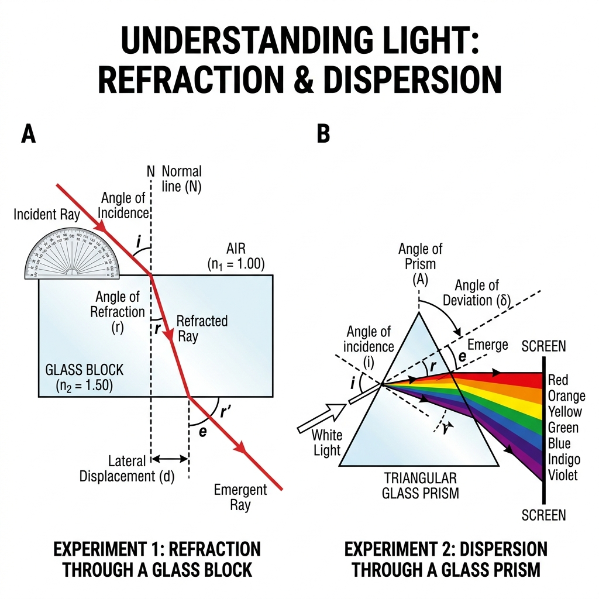
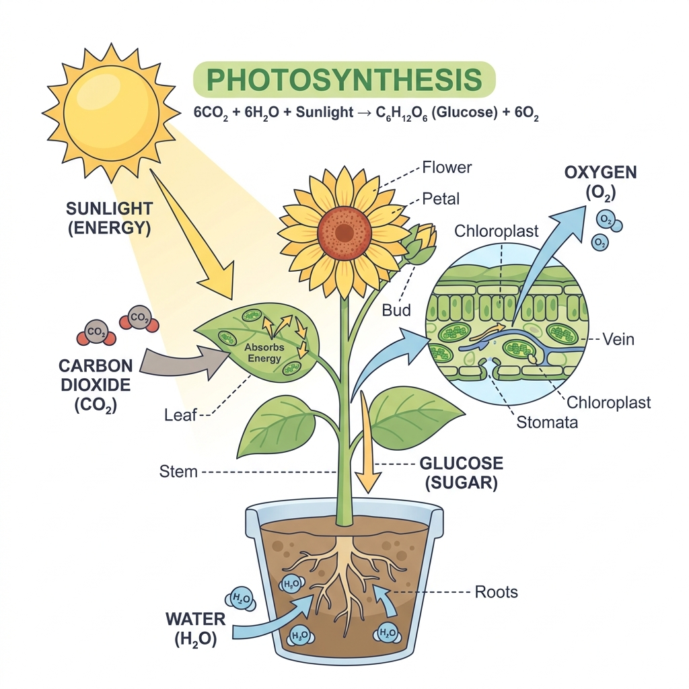

# Portofolio AI Image Generation & QC Kelayakan Soal (Edutech)

Repositori ini menampilkan studi kasus pembuatan aset visual/gambar menggunakan Generative AI serta proses Quality Control (QC) kelayakan soal untuk konten pembelajaran dan bank soal Edutech.

Fokus utama adalah memastikan setiap gambar ilustrasi memiliki akurasi konsep ilmiah yang presisi, gaya visual yang konsisten, dan benar-benar mendukung pemahaman siswa tanpa menimbulkan ambiguitas soal.

---

## Studi Kasus 1: Soal Matematika Trigonometri (Sudut Elevasi)



### 1. Struktur Prompt AI
```text
Clean 2D educational textbook vector illustration of a trigonometry word problem: a student observing the top of a lighthouse from a horizontal ground distance, right-angled triangle overlay labeled with angle of elevation theta, height h, distance d, and a 90-degree right angle symbol at the base. Crisp line art, clean flat color, pure white background, no clutter.
```

### 2. Format Soal Latihan
* **Topik:** Trigonometri Dasar (Sudut Elevasi)
* **Tingkat:** SMA Kelas X
* **Pertanyaan:**  
  Seorang siswa mengamati puncak sebuah mercusuar setinggi $h$ meter dari jarak horizontal $d$ meter dari dasar mercusuar. Jika sudut elevasi yang terbentuk dari tanah menuju puncak mercusuar adalah $\theta = 30^\circ$ dan jarak horizontal $d = 60\sqrt{3}\text{ meter}$, berapakah tinggi mercusuar $h$?
* **Kunci Jawaban:** $h = d \cdot \tan(30^\circ) = 60\sqrt{3} \cdot \frac{1}{\sqrt{3}} = 60\text{ meter}$.

### 3. Lembar QC Kelayakan Soal
| Parameter Uji | Standar Evaluasi | Hasil QC |
| :--- | :--- | :--- |
| **Akurasi Geometris** | Segitiga siku-siku terdefinisi tegak lurus ($90^\circ$) pada dasar mercusuar. Sudut elevasi diukur dari bidang horizontal tanah. | **VALID** |
| **Konsistensi Visual** | Variabel $h$, $d$, dan $\theta$ terbaca jelas, tidak tumpang tindih dengan objek ilustrasi. | **VALID** |
| **Kesesuaian Pedagogis** | Gambar berfungsi sebagai stimulus kontekstual yang memperjelas soal cerita, bukan sekadar hiasan. | **VALID** |
| **Status Kelayakan** | **LAYAK TERBIT (Approved)** | |

---

## Studi Kasus 2: Soal Fisika Optik (Pembiasan dan Dispersi Cahaya)



### 1. Struktur Prompt AI
```text
Educational textbook vector diagram of physics optics experiment: side A showing light refraction through a rectangular glass block with labeled incident ray, normal line, angle of incidence i, angle of refraction r, and lateral displacement d; side B showing white light dispersion through a triangular glass prism splitting into rainbow spectrum from red to violet. Crisp textbook style, high clarity, white background.
```

### 2. Format Soal Latihan
* **Topik:** Gelombang Cahaya (Pembiasan dan Dispersi)
* **Tingkat:** SMA Kelas XI
* **Pertanyaan:**  
  Berdasarkan eksperimen pada gambar B, seberkas cahaya putih polikromatik mengalami penguraian warna (dispersi) saat melewati prisma kaca. Mengapa cahaya warna merah mengalami deviasi (pembelokan) paling kecil dibandingkan cahaya warna ungu?
* **Kunci Jawaban:** Karena cahaya merah memiliki panjang gelombang paling besar dalam spektrum tampak, sehingga indeks bias medium kaca terhadap cahaya merah lebih kecil daripada terhadap cahaya ungu ($n_{\text{merah}} < n_{\text{ungu}}$).

### 3. Lembar QC Kelayakan Soal
| Parameter Uji | Standar Evaluasi | Hasil QC |
| :--- | :--- | :--- |
| **Hukum Pembiasan** | Garis normal tegak lurus bidang batas medium. Arah pembelokan saat memasuki medium lebih rapat (udara ke kaca) mendekati garis normal. | **VALID** |
| **Akurasi Spektrum** | Urutan dispersi warna dari atas ke bawah tepat (Merah, Jingga, Kuning, Hijau, Biru, Nila, Ungu). | **VALID** |
| **Keterbacaan Label** | Simbol sudut datang ($i$), sudut bias ($r$), dan sudut deviasi ($\delta$) terposisikan dengan presisi. | **VALID** |
| **Status Kelayakan** | **LAYAK TERBIT (Approved)** | |

---

## Studi Kasus 3: Soal Biologi (Struktur Tumbuhan dan Fotosintesis)



### 1. Struktur Prompt AI
```text
Educational vector infographic for biology exam: plant structure and photosynthesis process showing sunlight energy absorption on leaf, CO2 input, water absorption from roots, and outputs of oxygen (O2) and glucose sugar, with cross-section zoom-in of leaf showing stomata and chloroplasts. Clean textbook diagram style, pastel tones, clear labels, white background.
```

### 2. Format Soal Latihan
* **Topik:** Fisiologi Tumbuhan (Fotosintesis)
* **Tingkat:** SMP Kelas VIII / SMA Kelas XII
* **Pertanyaan:**  
  Perhatikan diagram proses fotosintesis pada gambar. Bagian daun yang ditunjuk oleh lingkaran perbesaran memperlihatkan struktur penampang melintang daun. Pertukaran gas karbon dioksida ($CO_2$) yang masuk dan oksigen ($O_2$) yang dilepaskan ke udara luar terjadi melalui organel/struktur apa?
* **Kunci Jawaban:** Stomata (mulut daun).

### 3. Lembar QC Kelayakan Soal
| Parameter Uji | Standar Evaluasi | Hasil QC |
| :--- | :--- | :--- |
| **Reaksi Kimiawi** | Persamaan reaksi $6CO_2 + 6H_2O \rightarrow C_6H_{12}O_6 + 6O_2$ tertulis seimbang dan akurat. | **VALID** |
| **Anatomi Visual** | Penampang kloroplas dan letak stomata pada epidermis bawah digambarkan sesuai fakta biologis. | **VALID** |
| **Bebas Distorsi AI** | Tidak ada artefak visual aneh pada jari-jari bunga atau pembuluh akar yang dapat membingungkan siswa. | **VALID** |
| **Status Kelayakan** | **LAYAK TERBIT (Approved)** | |

---

## Standar Operasional Prosedur (SOP) QC Kelayakan Soal

Dalam proses produksi konten Edutech, setiap visual dan soal melalui 4 tahap validasi:

1. **Analisis Kebutuhan Pedagogis:** Menentukan apakah soal memerlukan stimulus visual (diagram konsep, skenario soal cerita, atau grafik data) untuk menguji kompetensi siswa.
2. **Prompt Crafting:** Menyusun prompt deskriptif dengan kontrol gaya visual vektor edukatif, sudut pandang kamera, dan komposisi yang rapi di atas latar bersih.
3. **Pemeriksaan Visual (Anti-Halusinasi AI):** Mengaudit hasil generate gambar terhadap artefak AI, teks halusinasi, dan ketidaksesuaian anatomi/geometri.
4. **Verifikasi Kebenaran Akademis:** Memastikan keselarasan penuh antara gambar, narasi soal, pilihan ganda, dan kunci jawaban.
